# Futebol Manager — Documentação

**Universidade Luterana do Brasil (ULBRA) — Campus Torres**
**Curso:** Análise e Desenvolvimento de Sistemas
**Disciplina:** Algoritmos e Estruturas de Dados
**Professor:** Juliano Ramos Matos
**Trabalho:** Avaliação Semestral — Projeto Futebol Manager
**Equipe:** Equipe Individual — Matheus Schuh (1 integrante)

---

## Sumário

1. [Resumo e regras do jogo](#1-resumo-e-regras-do-jogo)
2. [Estrutura para jogadores e clubes](#2-estrutura-para-jogadores-e-clubes)
3. [Lista Duplamente Ligada Circular (tabuleiro)](#3-lista-duplamente-ligada-circular-tabuleiro)
4. [Pilha (baralho e descarte)](#4-pilha-baralho-e-descarte)
5. [Fila (histórico)](#5-fila-histórico)
6. [Passagem pelo Início](#6-passagem-pelo-início)
7. [Divisão de tarefas e declaração de uso de IA](#7-divisão-de-tarefas-e-declaração-de-uso-de-ia)
8. [Funcionamento do jogo (screenshots)](#8-funcionamento-do-jogo-screenshots)
9. [Decisões e interpretações adotadas](#9-decisões-e-interpretações-adotadas)

---

## 1. Resumo e regras do jogo

O Futebol Manager é um jogo de tabuleiro para console, escrito em Java 17, inspirado no futebol. Cada jogador é um gestor que administra seu dinheiro, compra clubes, cobra taxas de mando de campo de quem para nos seus clubes e tenta terminar a partida com o maior patrimônio.

**Escopo da equipe de 1 integrante:** conforme o item 1.1 do enunciado, esta versão implementa o núcleo do jogo **sem as casas Leilão e Série B**. Por isso não há fila de rebaixados (só a fila do histórico), a carta 9 ("Vá para a Série B") foi substituída por outra carta de perda, e os screenshots S5, S6 e S12 não se aplicam.

### Como uma partida funciona

- **Configuração:** cadastro de clubes (mínimo 10, máximo 40), de jogadores (mínimo 2, máximo 6, na ordem dos turnos) e das configurações da partida (saldo inicial, patrocínio, máximo de rodadas, capacidade do histórico e semente). Há uma opção que carrega os 14 clubes do Campeonato Brasileiro (tabela 7.1 do enunciado) e 3 jogadores de teste.
- **Turno:** o jogador lança dois dados, anda **nó a nó** pelo tabuleiro e sofre o efeito da casa onde parou.
- **Rodada:** todos os jogadores ativos jogam um turno, na ordem de cadastro.
- **Fim:** a partida termina ao atingir o número máximo de rodadas ou quando resta um único jogador não eliminado. O relatório final mostra a classificação por patrimônio e as estatísticas.

### Tipos de casa

| Casa | Efeito |
|---|---|
| **Início** | Ao chegar ou passar por ela andando para frente, o jogador recebe o patrocínio e completa uma temporada (regras detalhadas na seção 6). |
| **Clube** | Sem dono: o jogador pode comprar. Do próprio jogador: nada acontece. De outro jogador: o visitante paga a taxa de mando ao dono. |
| **Sorte/Revés** | O jogador tira a carta do topo do baralho e o efeito é aplicado na hora. |
| **Folha Salarial** | O jogador paga ao banco 1% do valor original de cada clube que possui. |
| **Premiação de Títulos** | O jogador recebe do banco 2% do valor original de cada clube que possui. |

### Valorização dos clubes

Cada clube tem um **multiplicador** que começa em 1,0. A cada visita de quem não é o dono, ele aumenta 0,1, até o máximo de 2,0. A taxa cobrada é `taxa base × multiplicador`, arredondada para centavos. A visita em que o jogador compra o clube não conta, e um clube que volta ao banco tem o multiplicador zerado para 1,0.

### Pagamentos, venda forçada e falência

Toda cobrança passa por um único método (`cobrar`), que segue a regra do item 2.4:

1. Se o saldo cobre o valor, o valor é debitado.
2. Se não cobre, acontece a **venda forçada**: o jogador vende clubes ao banco, do menor para o maior valor original, por 50% do valor, até cobrir a dívida. Os clubes vendidos voltam ao banco com multiplicador 1,0.
3. Se nem vendendo todos os clubes a dívida é coberta, o jogador **vai à falência**: o credor recebe tudo o que restava, o jogador é eliminado e o patrimônio dele passa a ser zero.

---

## 2. Estrutura para jogadores e clubes

Tanto os jogadores da partida quanto os clubes de cada jogador são guardados em `ArrayList`, que o enunciado permite como apoio, com justificativa.

**Por que `ArrayList` é adequado aqui**, com base nas operações que o jogo realmente faz:

| Operação | Onde acontece | Como o `ArrayList` resolve |
|---|---|---|
| Inserir | cadastro de jogador, compra de clube | `add` no final, mantendo a ordem de cadastro (que define a ordem dos turnos) |
| Remover um elemento específico | remover um cadastro, venda forçada (um clube do meio da lista) | `remove` de qualquer posição |
| Buscar | verificar nomes repetidos, achar o clube mais barato | percorrer com `for` |
| Iterar na ordem de turno | rodada, folha salarial, premiação, patrimônio | `for-each` na ordem de inserção |
| Contar | limite de 40 clubes e 6 jogadores, relatório | `size()` |

Uma **pilha** ou uma **fila** não serviriam, porque só permitem remover das pontas, e a venda forçada precisa remover um clube específico do meio da coleção.

Cada `Clube` guarda uma **referência** para o objeto `Jogador` dono (e não o nome dele). Assim, ao cobrar a taxa de mando, o jogo credita direto no saldo do dono, sem precisar procurar o jogador pelo nome. `dono == null` significa que o clube pertence ao banco.

```java
public class Jogador {
    private String nome;
    private double saldo;
    private No<Casa> posicaoAtual;            // o nó do tabuleiro onde o jogador está
    private ArrayList<Clube> clubesAdquiridos;
    private int temporadasCompletas;
    private boolean eliminado;
    private int voltasPendentes;
    private double totalRecebidoTaxas;

    public double calcularPatrimonio() {
        double patrimonioTotal = saldo;
        for (Clube clube : clubesAdquiridos) {
            patrimonioTotal += clube.getValorAquisicao();
        }
        return patrimonioTotal;
    }
}
```

```java
public class Clube {
    private String nome;
    private double valorAquisicao;
    private double taxaMandoBase;
    private Jogador dono;          // null = sem dono (banco)
    private double multiplicador;  // começa em 1.0, teto 2.0

    public void registrarVisita() {
        if (multiplicador >= 2.0) {
            return;
        }
        multiplicador += 0.1;
        multiplicador = Math.round(multiplicador * 10) / 10.0;  // evita o erro acumulado do double
    }

    public double calcularTaxa() {
        double taxaCobrada = taxaMandoBase * multiplicador;
        return Math.round(taxaCobrada * 100) / 100.0;           // arredonda para centavos
    }
}
```

O `multiplicador` não tem setter: ele só muda pelas regras do jogo (`registrarVisita` e `voltarAoBanco`). O arredondamento em `registrarVisita` foi necessário porque o `double` não representa 0,1 exatamente: somando 0,1 dez vezes, o valor chegava em `2.000000000000001` e passava do teto.

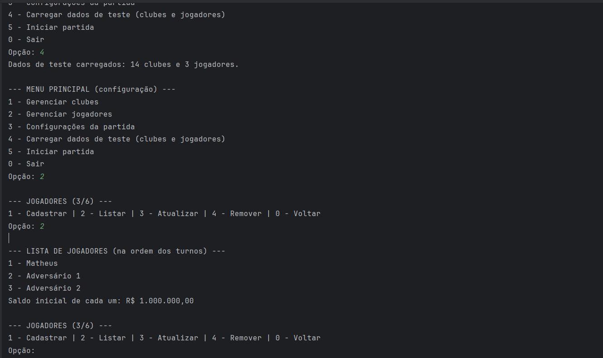
**[S1]** Cadastro e listagem de jogadores. Os jogadores são listados na ordem de cadastro, que define a ordem dos turnos.

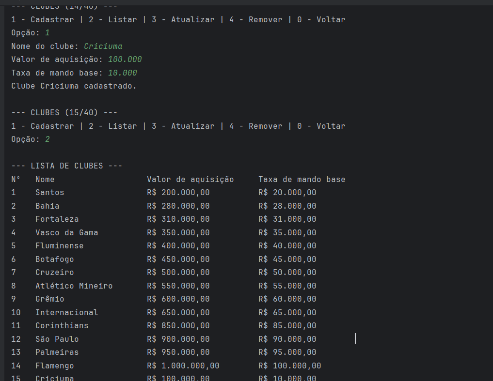
**[S2]** Cadastro de um clube novo (Criciúma) e listagem dos 15 clubes, com nome, valor de aquisição e taxa de mando base.

---

## 3. Lista Duplamente Ligada Circular (tabuleiro)

O tabuleiro é uma **Lista Duplamente Ligada Circular** (`ListaDuplaCircular<Casa>`) implementada manualmente. Cada nó é uma casa, com ponteiros `proximo` e `anterior`, e o último nó está ligado ao primeiro nos dois sentidos.

### Por que ela é melhor que uma lista simples ou um vetor

- **Circular:** o tabuleiro não tem fim. Como o último nó aponta para o primeiro, o jogador dá voltas seguindo `proximo`, sem nenhum caso especial e sem contas como `(posicao + n) % T`.
- **Duplamente ligada:** as cartas de retrocesso precisam andar para trás. Com o ponteiro `anterior`, isso é feito nó a nó, igual ao movimento para frente. Numa lista simples, andar uma casa para trás exigiria percorrer o círculo quase inteiro.
- **Melhor que um vetor:** com vetor, o movimento seria feito com índices e aritmética, o que o enunciado proíbe. Além disso, andando nó a nó, o jogo **detecta a passagem pelo Início durante o movimento**, casa por casa (seção 6), o que com um salto de índice não seria natural.

### Inserção que fecha o círculo

```java
public void adicionarNoFim(T dado) {
    No<T> novo = new No<>(dado);

    if (estaVazia()) {
        // um nó sozinho forma um círculo consigo mesmo
        inicio = novo;
        fim = novo;
        novo.proximo = novo;
        novo.anterior = novo;
    } else {
        fim.proximo = novo;
        novo.anterior = fim;

        // fecha o círculo: novo fim <-> início
        novo.proximo = inicio;
        inicio.anterior = novo;

        fim = novo;
    }
    tamanho++;
}
```

### Movimento nó a nó

O jogador guarda o **nó** onde está (`No<Casa> posicaoAtual`) e anda seguindo os ponteiros, uma casa por vez:

```java
public void avancarUmaCasa() {
    posicaoAtual = posicaoAtual.getProximo();
}

public void recuarUmaCasa() {
    posicaoAtual = posicaoAtual.getAnterior();
}
```

A classe `No` expõe `proximo`, `anterior` e `dado` só para **leitura** (getters). Assim, nenhuma classe de fora do pacote `estruturas` consegue alterar as ligações e "abrir" o círculo do tabuleiro por engano.

### Montagem do tabuleiro

O tabuleiro tem `T = N + E` casas (`N` clubes e `E = 4` casas especiais: Início, Sorte/Revés, Folha Salarial e Premiação). A k-ésima casa especial fica na posição `round(k × T / E)`, e as posições restantes recebem os clubes na ordem de cadastro. Um vetor é usado **apenas durante a montagem**, para calcular essas posições. Depois, as casas são inseridas em ordem na lista circular, e o jogo nunca mais usa índices.

Com os 15 clubes do S3 (T = 19): as especiais ficam nas posições 0, round(4,75) = 5, round(9,5) = 10 e round(14,25) = 14.

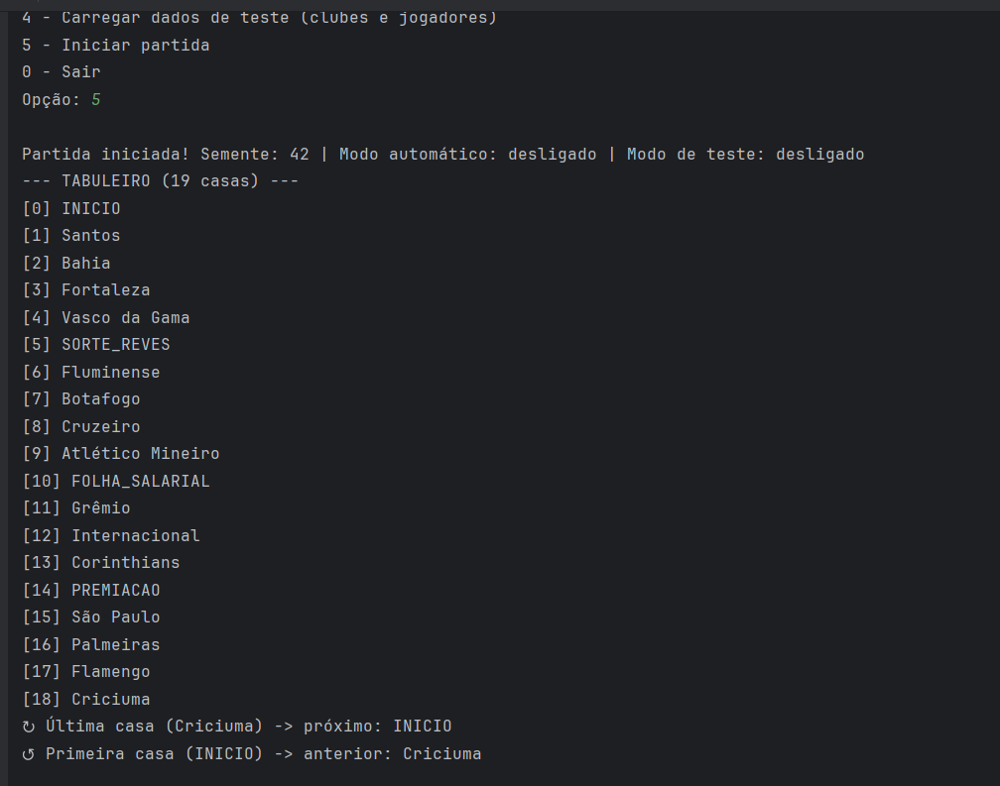
**[S3]** Tabuleiro criado com 19 casas. As duas últimas linhas evidenciam a ligação circular nos dois sentidos: o `proximo` da última casa (Criciúma) é o INICIO, e o `anterior` do INICIO é o Criciúma.

---

## 4. Pilha (baralho e descarte)

O baralho de Sorte/Revés usa **duas pilhas** (`Pilha<Carta>`) implementadas manualmente: o **baralho** e o **descarte**.

### LIFO

A carta tirada é sempre a do **topo**, a última que entrou (*Last In, First Out*). Depois de aplicada, ela é empilhada no descarte.

```java
public Carta comprar() {
    if (baralho.estaVazia()) {
        reabastecer();
    }
    return baralho.desempilhar();
}

public void descartar(Carta carta) {
    descarte.empilhar(carta);
}
```

### Reabastecimento

Quando o baralho esvazia, as cartas do descarte são reunidas, embaralhadas e empilhadas de novo no baralho, automaticamente. Como uma pilha só permite acesso ao topo, as cartas são passadas para um vetor temporário, onde o embaralhamento pode trocar qualquer posição.

```java
private void reabastecer() {
    System.out.println("   ** Baralho vazio! O descarte (" + descarte.tamanho() + " cartas) foi embaralhado e empilhado de novo.");
    Carta[] cartas = new Carta[descarte.tamanho()];
    for (int i = 0; i < cartas.length; i++) {
        cartas[i] = descarte.desempilhar();
    }
    embaralharEEmpilhar(cartas);
}
```

### Embaralhamento: algoritmo de Fisher-Yates

O vetor é percorrido do fim para o início. Para cada posição `i`, sorteia-se uma posição `j` entre 0 e `i`, e as duas cartas são trocadas. A cada passo, a carta da posição `i` fica definida, e o sorteio acontece só entre as cartas restantes. Assim, toda ordem possível tem a mesma probabilidade de ocorrer.

```java
private void embaralhar(Carta[] cartas) {
    for (int i = cartas.length - 1; i >= 1; i--) {
        int j = random.nextInt(i + 1);   // sorteia entre 0 e i
        Carta temp = cartas[i];
        cartas[i] = cartas[j];
        cartas[j] = temp;
    }
}
```

O `Random` é o mesmo usado nos dados e é criado com a **semente configurável**. Com a mesma semente, a ordem das cartas e os dados se repetem, o que permite reproduzir uma partida.

Em teste, comprando e descartando 36 cartas seguidas (três ciclos de 12, com dois reabastecimentos), cada ciclo saiu numa ordem diferente, sempre com as 12 cartas e nenhuma repetida.

### Modo de teste: escolher a carta do topo

O modo de teste permite escolher qual carta estará no topo. Para tirar uma carta do **meio** da pilha sem alterar a ordem das demais, o jogo usa uma **pilha auxiliar**: desempilha tudo para a auxiliar (deixando de fora a carta escolhida), devolve as outras na mesma ordem e, por fim, empilha a escolhida no topo.

```java
private boolean removerDaPilha(Pilha<Carta> pilha, Carta alvo) {
    Pilha<Carta> auxiliar = new Pilha<>();
    boolean achou = false;
    while (!pilha.estaVazia()) {
        Carta carta = pilha.desempilhar();
        if (!achou && carta == alvo) {
            achou = true;
        } else {
            auxiliar.empilhar(carta);
        }
    }
    while (!auxiliar.estaVazia()) {
        pilha.empilhar(auxiliar.desempilhar());
    }
    return achou;
}
```

### As 12 cartas

São 6 cartas de ganho ou avanço e 6 de perda ou retrocesso, com os efeitos da tabela 2.5. Cada carta guarda o texto, o tipo de efeito (`enum TipoEfeito`) e o valor. Quem aplica o efeito é a classe `Jogo`, com um `switch` sobre o tipo, porque vários efeitos envolvem outros jogadores, o movimento e a venda forçada.

Equipe de 1 integrante: a carta 9 ("Vá para a Série B") foi substituída por **"Pague R$ 20.000 pelo tratamento de um jogador lesionado"**.

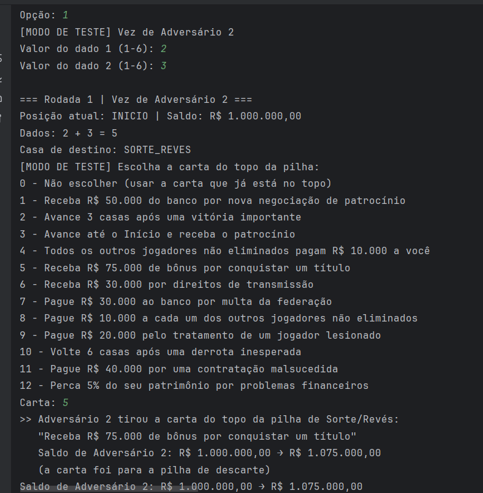
**[S4]** Carta de Sorte/Revés: o Adversário 2 parou na casa Sorte/Revés (dados 2 + 3), a carta do topo é "Receba R$ 75.000 de bônus por conquistar um título", o efeito é aplicado (saldo de R$ 1.000.000,00 para R$ 1.075.000,00) e a carta vai para o descarte. O print foi feito no modo de teste, que mostra a lista de cartas para escolher a do topo.

---

## 5. Fila (histórico)

O histórico de rodadas é uma **Fila** (`Fila<EntradaHistorico>`) implementada manualmente, sem `java.util.Queue`.

Cada entrada (`EntradaHistorico`) contém: número da rodada, nome do jogador, os dois dados lançados, a casa de destino e o efeito aplicado.

### O que acontece quando a fila lota

A fila tem uma **capacidade máxima N**, configurável (padrão 10). Antes de inserir, se a fila estiver cheia, a entrada **mais antiga** (a do início da fila, a primeira que entrou) é removida automaticamente. Assim, o tamanho fica parado na capacidade: sai uma, entra uma.

```java
public void enfileirar(T e) {
    No<T> novoNo = new No<>(e);

    if (tamanho == capacidade) {
        desenfileirar();   // descarta a entrada mais antiga
    }

    if (inicio == null) {
        inicio = novoNo;
        fim = novoNo;
    } else {
        fim.proximo = novoNo;
        fim = novoNo;
    }
    tamanho++;
}
```

Exemplo com capacidade 3:

```
enfileirar(A) → [A]
enfileirar(B) → [A, B]
enfileirar(C) → [A, B, C]   ← cheia
enfileirar(D) → [B, C, D]   ← A saiu sozinha
enfileirar(E) → [C, D, E]   ← B saiu sozinha
```

O construtor garante que a capacidade seja pelo menos 1 (um valor zero ou negativo vira o padrão 10), para que a fila nunca fique num estado inválido.

### Percorrer sem remover

O histórico pode ser exibido a qualquer momento pelo menu, sem esvaziar a fila: o método `exibir` percorre os nós do início ao fim, apenas lendo.

**Fila de rebaixados:** não se aplica à equipe de 1 integrante (não há a casa Série B).

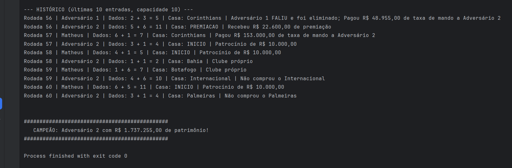
**[S7]** Histórico com 10 entradas, ao fim de uma partida de 60 rodadas. A fila está lotada: só aparecem as rodadas 56 a 60, porque as entradas mais antigas foram descartadas automaticamente a cada nova inserção.

---

## 6. Passagem pelo Início

### Detecção durante o movimento

Como o jogador anda **nó a nó**, a passagem pelo Início é verificada **a cada passo**: depois de avançar uma casa, o jogo checa se a casa atual é o Início. Assim, o patrocínio é pago tanto para quem **para** no Início quanto para quem só **passa** por ele.

### Voltas pendentes: por que retrocessos não pagam

Retrocessos nunca concedem patrocínio. Para evitar o truque de "voltar e avançar de novo" (recuar até antes do Início e depois avançar por ele para receber outra vez), cada jogador tem um contador de **voltas pendentes**:

- ao **sair** do Início andando para trás, `voltasPendentes` aumenta em 1;
- ao chegar ao Início andando para frente, se `voltasPendentes > 0`, ela diminui em 1 e **não há patrocínio** (reposição de volta). Caso contrário, o jogador recebe normalmente.

No retrocesso, a verificação é feita **antes** do passo, porque a regra fala em **sair** do Início: depois do passo, o jogador já estaria em outra casa.

```java
public void moverParaFrente(Jogador jogador, int passos) {
    for (int i = 0; i < passos; i++) {
        jogador.avancarUmaCasa();

        if (jogador.getPosicaoAtual().getDado().getTipo() == TipoCasa.INICIO) {
            if (jogador.getVoltasPendentes() > 0) {
                jogador.quitarVoltaPendente();        // reposição de volta: sem patrocínio
            } else {
                jogador.receber(patrocinio);
                jogador.completarTemporada();
            }
        }
    }
}

public void moverParaTras(Jogador jogador, int passos) {
    for (int i = 0; i < passos; i++) {
        if (jogador.getPosicaoAtual().getDado().getTipo() == TipoCasa.INICIO) {
            jogador.adicionarVoltaPendente();         // vai SAIR do Início para trás
        }
        jogador.recuarUmaCasa();
    }
}
```

O exemplo do enunciado (jogador na casa 2 recua 3 e depois avança 3) foi testado: ao recuar, `voltasPendentes` passa para 1; ao avançar, a pendência é quitada e não há patrocínio. Numa volta completa seguinte, o patrocínio volta a ser pago normalmente.

> **Observação sobre o S9 (carta "Volte" configurável):** a única forma de andar para trás é a carta "Volte", que só é tirada na casa Sorte/Revés. Com o tabuleiro de uma equipe de 1 integrante, essa casa fica, no mínimo, na posição 4 (fórmula `round(T/4)`, com T ≥ 14). Voltando 3 casas, o jogador para, no máximo, na posição 1, sem nunca cruzar o Início, e o S9 seria impossível de reproduzir. Como a tabela de cartas indica "valores configuráveis no código", o número de casas da carta "Volte" virou uma configuração (padrão 3). Para o S9, ela foi configurada com 6 casas.

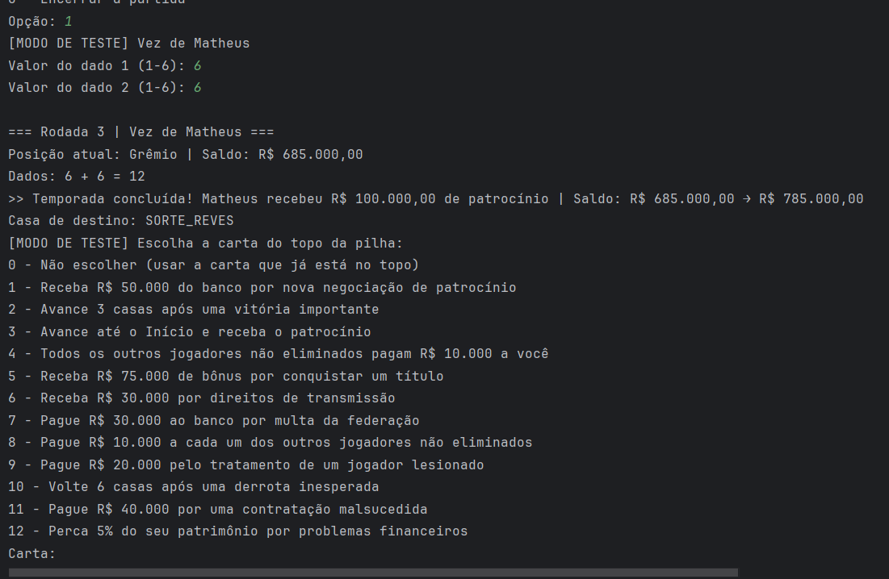
**[S8]** Passagem pelo Início com patrocínio: o Matheus estava no Grêmio e tirou 6 + 6. Durante o movimento, ao passar pelo Início, recebeu R$ 100.000,00 de patrocínio e o saldo foi de R$ 685.000,00 para R$ 785.000,00. O movimento continuou até a casa Sorte/Revés.

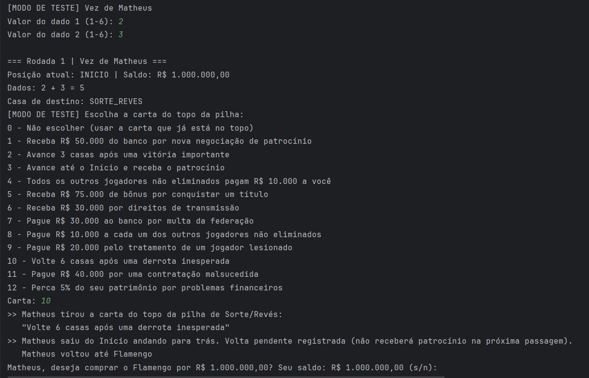
**[S9a]** Retrocesso cruzando o Início: com o modo de teste, o Matheus parou na casa Sorte/Revés e tirou "Volte 6 casas". Ao sair do Início andando para trás, a volta pendente foi registrada, e ele parou no Flamengo.

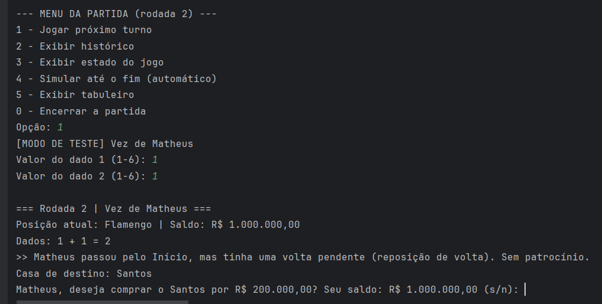
**[S9b]** No turno seguinte, o Matheus tirou 1 + 1 e passou pelo Início andando para frente. Como tinha uma volta pendente, houve reposição de volta, **sem patrocínio**, com mensagem explícita. O saldo continua R$ 1.000.000,00.

---

## 7. Divisão de tarefas e declaração de uso de IA

### Divisão de tarefas

O trabalho foi feito individualmente, por Matheus Schuh.

### Uso de IA

Foi utilizado o assistente **Claude** (Anthropic), como mentor e apoio na escrita do código e da documentação.

**Partes escritas por mim, com orientação da IA** (explicações, pistas e correção dos erros que eu cometia):

- as estruturas `ListaDuplaCircular` (adaptada da `ListaDupla` da AP2 e da `ListaCircular` vista em aula), `Pilha` e `Fila` (com o limite de capacidade e a validação no construtor);
- os modelos `Clube` (incluindo o multiplicador com teto e arredondamento), `Jogador`, `Casa`, `Carta`, `EntradaHistorico` e os enums `TipoCasa` e `TipoEfeito`;
- na classe `Jogo`: o movimento nó a nó com a regra do Início e das voltas pendentes (`moverParaFrente` e `moverParaTras`), a casa de clube com compra, taxa de mando e valorização (`pararEmClube`), a Folha Salarial e a Premiação (`pararEmFolhaSalarial` e `pararEmPremiacao`) e o lançamento dos dados (`lancarDado`);
- na classe `Baralho`: a pilha com descarte, o reabastecimento e o embaralhamento de Fisher-Yates;
- na classe `Ranking`: a ordenação manual da classificação (bubble sort).

**Partes escritas pela IA, revisadas e testadas por mim:**

- a montagem do tabuleiro (classe `Tabuleiro`);
- na classe `Jogo`: a cobrança com venda forçada e falência (`cobrar`), a aplicação dos efeitos das cartas, o turno, a rodada, o fim de jogo, o registro do histórico e o relatório final;
- na classe `Baralho`: a lista das 12 cartas e a escolha da carta do topo no modo de teste (com a pilha auxiliar);
- os menus, os cadastros, a validação de entrada, a formatação de valores, as configurações, os dados de teste e os modos de teste e automático;
- o rascunho desta documentação.

### Como o resultado foi verificado

- Cada parte foi testada assim que ficou pronta, antes de seguir para a próxima. Por exemplo: a lista circular foi percorrida nos dois sentidos, a fila foi testada com capacidade 3 e 5 inserções, o baralho foi testado com 36 compras seguidas, e o exemplo de voltas pendentes do enunciado foi reproduzido.
- Foram jogadas partidas completas, no modo manual, no modo de teste e no modo automático, conferindo os valores na tela: taxas, folha, premiação, saldos antes e depois e a classificação.
- Os screenshots foram reproduzidos com a semente configurável e o modo de teste.

---

## 8. Funcionamento do jogo (screenshots)

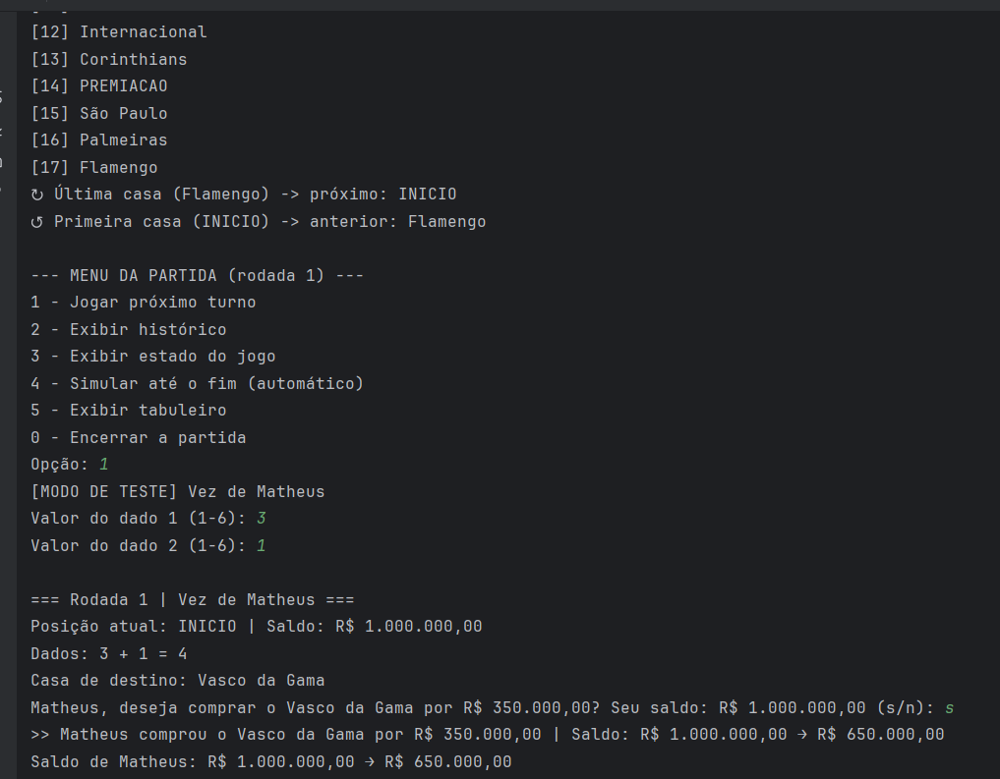
**[S10]** Compra de clube: o Matheus tirou 3 + 1, parou no Vasco da Gama (sem dono), confirmou a compra e o saldo foi de R$ 1.000.000,00 para R$ 650.000,00.

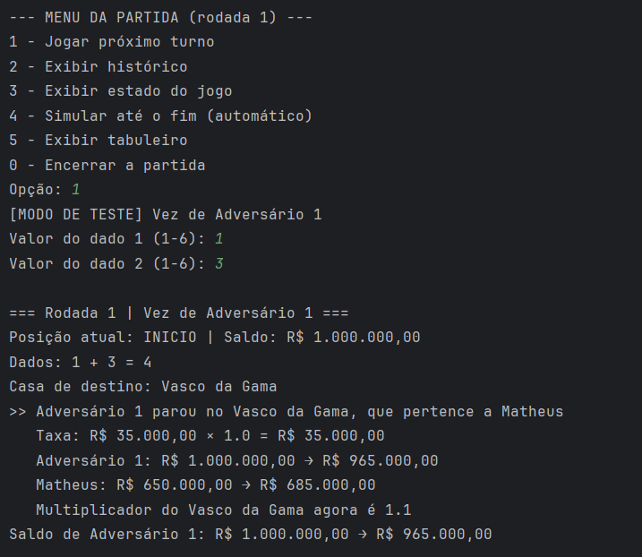
**[S11]** Taxa de mando de campo: o Adversário 1 parou no Vasco da Gama, que pertence ao Matheus. Cálculo: R$ 35.000,00 × 1,0 = R$ 35.000,00. Débito no Adversário 1 (R$ 1.000.000,00 → R$ 965.000,00) e crédito no Matheus (R$ 650.000,00 → R$ 685.000,00). Depois da cobrança, o multiplicador do clube subiu para 1,1.

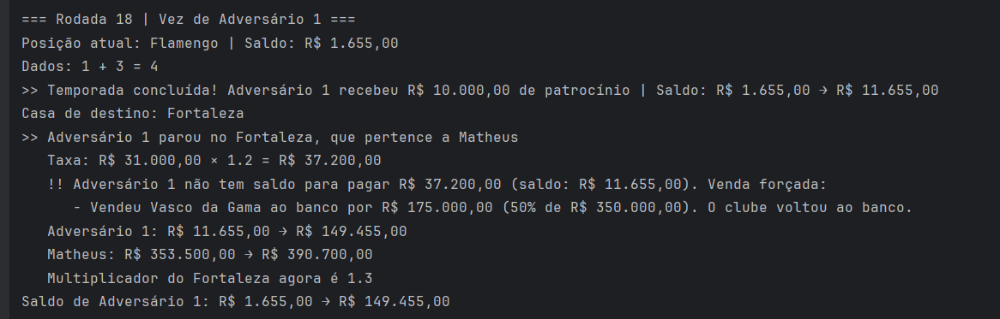
**[S13a]** Crise financeira, venda forçada: o Adversário 1 precisava pagar R$ 37.200,00 de taxa, mas tinha R$ 11.655,00. Vendeu o seu clube mais barato (Vasco da Gama) ao banco por 50% do valor original (R$ 175.000,00), o clube voltou ao banco e a taxa foi paga. Partida no modo automático, com patrocínio de R$ 10.000,00 e semente 5.

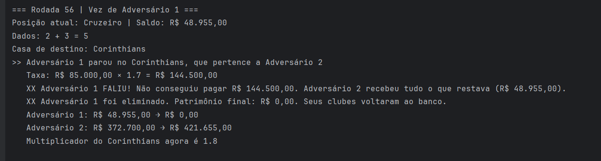
**[S13b]** Crise financeira, falência: na rodada 56, o Adversário 1 precisava pagar R$ 144.500,00 e não tinha clubes para vender. O Adversário 2 recebeu tudo o que restava (R$ 48.955,00), e o Adversário 1 foi eliminado com patrimônio final de R$ 0,00, com mensagem de que os clubes voltaram ao banco.

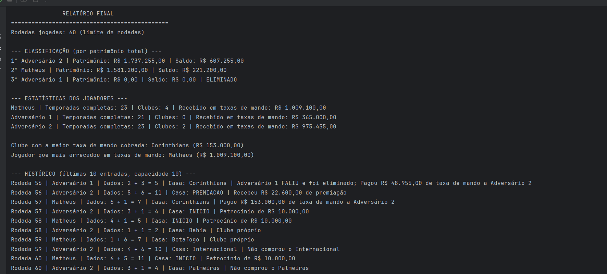
**[S14a]** Encerramento, parte 1: relatório final depois de 60 rodadas. Classificação por patrimônio total (ordenada com bubble sort; o eliminado fica por último), temporadas completas e clubes de cada jogador, clube com a maior taxa de mando cobrada (Corinthians, R$ 153.000,00) e jogador que mais arrecadou em taxas de mando (Matheus, R$ 1.009.100,00).


**[S14b]** Encerramento, parte 2: histórico das últimas 10 rodadas e campeão (Adversário 2, com R$ 1.737.255,00 de patrimônio).

---

## 9. Decisões e interpretações adotadas

- **Ordem da cobrança e da valorização:** na visita de um adversário, a taxa é cobrada com o multiplicador **atual**, e só depois o multiplicador aumenta 0,1. Ou seja, a visita valoriza o clube para os próximos visitantes (o primeiro visitante paga com 1,0).
- **Carta 9 substituída** (equipe de 1 integrante): "Pague R$ 20.000 pelo tratamento de um jogador lesionado".
- **Carta "Volte" configurável:** padrão 3 casas, configurável para permitir o S9 (explicação na seção 6).
- **Carta de Sorte/Revés que leva a outra casa:** o efeito da casa de destino é aplicado, exceto Sorte/Revés, conforme o enunciado (nenhuma nova carta é sorteada).
- **Modo automático:** compra o clube se o saldo depois da compra ficar acima de 10% do saldo inicial (sugestão do enunciado).
- **Classificação final:** jogadores ativos ordenados por patrimônio (empate: maior saldo), seguidos dos eliminados na ordem inversa de eliminação.
- **Jogadores de teste:** como a equipe tem um único integrante, os dados de teste usam "Matheus" e dois jogadores genéricos ("Adversário 1" e "Adversário 2").
- **Banco:** não é um objeto do jogo. Pagamentos ao banco usam credor `null`, e recebimentos do banco apenas somam ao saldo, já que o banco tem recursos ilimitados.
